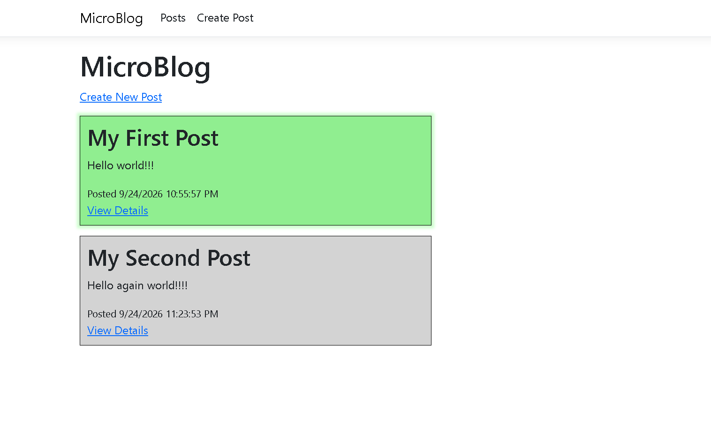
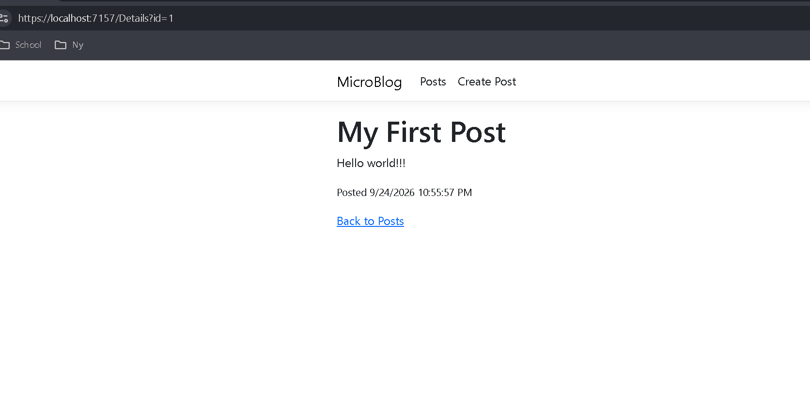

# MicroBlog

This is a web-based MicroBlog application that allows users to:
1. Create posts
2. View existing posts
3. View the details of individual posts

## Screenshots

### Index Page



### Details Page



### Create Page


## Repositories and Dependency Injection

This version of MicroBlog uses the repository pattern and dependency injection to manage blog posts.

The `IBlogRepository` interface defines the methods used by the application:

- `GetAll()` gets all posts.
- `GetById(int id)` gets a post by its ID.
- `Add(Post post)` adds a new post.
- `Save()` saves changes.

There are two repository implementations:

- `InMemoryBlogRepository` stores posts in a list while the application is running.
- `JsonBlogRepository` reads and writes posts using `data/posts.json`.

### Switching Repositories

The repository being used is registered in `Program.cs`.

The application currently uses the JSON repository:

```csharp
builder.Services.AddSingleton<IBlogRepository, JsonBlogRepository>();
```

To use the in-memory repository instead, change it to:

```csharp
builder.Services.AddSingleton<IBlogRepository, InMemoryBlogRepository>();
```

The pages use `IBlogRepository`, so the repository can be switched without changing the code in each page.
